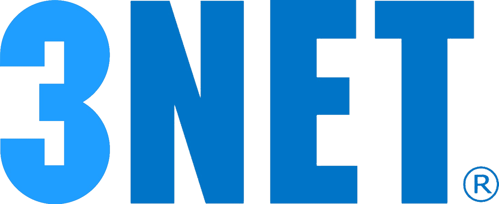
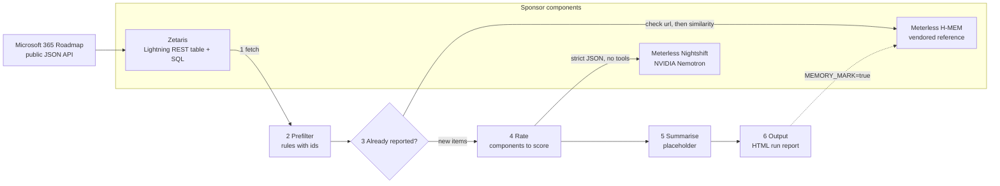

# 3NET News Agent



A weekly news agent that reads the public Microsoft 365 Roadmap, drops what is irrelevant with transparent rules, scores the rest with NVIDIA Nemotron, remembers what was already reported, and writes a report in which **every decision carries its reason**: the rule that dropped an item, the score components and reasoning behind a rating, the model that answered, and why an item counted as already reported.

Built for the **Open Agent Hackathon 2026** (GenAI.Works), track **The Agent That Can Explain Why**.

> **Status:** working prototype, built during the build window (22–27 October 2026). Daily progress is logged in [PROGRESS.md](PROGRESS.md). Everything marked *planned* is not in the repository yet.

## Contents

1. [Why it matters](#why-it-matters)
2. [What "explain why" means here](#what-explain-why-means-here)
3. [Architecture](#architecture)
4. [Pipeline status](#pipeline-status)
5. [Prefilter rules](#prefilter-rules)
6. [Scoring](#scoring)
7. [Model and routing transparency](#model-and-routing-transparency)
8. [Already reported: H-MEM memory](#already-reported-h-mem-memory)
9. [Sponsor technology and AI tools](#sponsor-technology-and-ai-tools)
10. [Quick start](#quick-start)
11. [Testing](#testing)
12. [Security and data](#security-and-data)
13. [Limitations and next steps](#limitations-and-next-steps)
14. [Pre-existing components and third-party code](#pre-existing-components-and-third-party-code)
15. [Data sources](#data-sources) · [License](#license)

## Why it matters

Team 3NET (3NET GmbH, Hamburg) is an IT service provider that wants to send its customers a weekly newsletter about Microsoft 365 changes that matter to them. The raw material is the Microsoft 365 Roadmap: on 2026-10-23 it listed **2,163 items**. Reading that by hand every week is slow, and most items concern products, clouds or roles the audience does not use.

The agent does the reading: it filters with rules, scores the remaining items for the target audience (end users and decision makers in small and medium-sized businesses using Microsoft 365), skips what was already reported, and explains every step so that a person can check the result before anything is sent.

| Phase | Goal |
| --- | --- |
| Hackathon prototype (now) | Pipeline with explainable decisions and an internal run report |
| Pilot (planned) | Weekly runs, review of the report by the team, calibration against labelled test sets |
| Customer newsletter (planned) | Newsletter draft built from the reviewed items |

## What "explain why" means here

Every decision in a run is recorded with its reason, in the run log (`data/runs/<run>.json`) and in the HTML run report (`data/out/<run>.html`):

| Decision | What is recorded |
| --- | --- |
| Item dropped by the prefilter | Rule id and reason, e.g. `VF-PRODUCT`: "all products out of scope: Power Automate" |
| Item rated | Score 0–10, its components (`baseValue`, `actionBonus`, `excluded`, `products`), the model's reasoning, the model that answered and its Meterless receipt id |
| Rating failed | Reason and number of attempts; the item gets no score |
| Item already reported | Stage that matched (`url` or `similarity`), the memory record and the similarity |

**Real example** from a run on 2026-10-23 (`RATE_ITEM_IDS=573696`):

| Field | Value |
| --- | --- |
| Item | 573696, "SharePoint: Copilot Search in SharePoint and OneDrive" |
| Prefilter | passed all rules |
| Components | `baseValue` 7 (a core product is the subject) + `actionBonus` 1 (concrete benefit for users), `excluded` false, products OneDrive, SharePoint |
| Score | **8** (computed in code: 7 + 1, cap for base 7 is 10) |
| Reasoning | "Copilot Search directly targets core Microsoft 365 products SharePoint and OneDrive, bringing AI-powered natural-language search to both. Preview begins this month (October 2026), giving users a concrete new capability to try without any required action." |
| Requested model | `nvidia/nemotron-3.5-lightning-30b-a3b` |
| Answering model | `nvidia/nemotron-3.5-super-vl-120b-a12b` (from the Meterless receipt, see [routing](#model-and-routing-transparency)) |
| Receipt id | `rcpt_req_xrxfo8v2` (the receipt signature is stored in the run log only) |

<!-- Screenshot of the HTML run report: assets/run-report.png (added later) -->

## Architecture



The pipeline is not an autonomous agent: the model only scores text. Each step talks to the outside world through a small interface (ports and adapters), so every sponsor component can be replaced:

| Port | Adapters in the repo | Without sponsor components |
| --- | --- | --- |
| `NewsSource` | `ZetarisNewsSource` (Microsoft 365 Roadmap via Zetaris) | `StubNewsSource` (`SOURCE=stub`) |
| `MemoryStore` | `HmemMemoryStore` (H-MEM) | `InMemoryMemoryStore` (`MEMORY=none`) |
| `RatingModel` | `NightshiftRatingModel` (Nemotron via Nightshift) | `StubRatingModel` (`RATER=stub`) |
| `Output` | `HtmlFileOutput` (run report) | `ConsoleOutput` (`OUTPUT=console`) |

All stub adapters are the defaults, so `npm run run` without any configuration runs the full pipeline on three fictional items without Zetaris, Nightshift or H-MEM.

## Pipeline status

| Step | What happens | Status |
| --- | --- | --- |
| 1. Fetch | Microsoft 365 Roadmap items are read through Zetaris (SQL over REST); the raw response is saved to `data/snapshots/` before mapping | Working |
| 2. Prefilter | Rules without AI, each with an id and a reason ([table](#prefilter-rules)) | Working |
| 3. Already reported? | Exact URL first, then similarity in H-MEM memory | Working (opt-in, `MEMORY=hmem`) |
| 4. Rate | Nemotron via Nightshift returns score components; the score is computed in code | Working |
| 5. Summarise | Short summary per item above the threshold | Placeholder (returns the title, not shown in the report) |
| 6. Output | HTML run report in `data/out/` | Working |
| 6b. Newsletter | Newsletter draft as HTML mail to a local SMTP catcher | Planned |
| Second source | DATEV maintenance-window calendar (ICS) with its own rule, as a neutral example | Planned |

## Prefilter rules

Rules run in this order; the first rule that drops an item decides, and its id and reason go into the run log. Numbers: 2026-10-23 snapshot (2,163 items) with the defaults `PREFILTER_NEW_DAYS=8` and `PREFILTER_HORIZON_MONTHS=3`.

| Rule id | Drops an item when | Example reason | Dropped on the snapshot |
| --- | --- | --- | --- |
| `required-fields` | title or URL is missing | "missing title or url" | 0 |
| `VF-NEU` | it was not modified in the last N days (rolling window) | "modified 2026-10-09, older than 8 days" | 1,817 |
| `VF-CLOUD` | no cloud instance contains "Worldwide" | "no Worldwide cloud (GCC, GCC High, DoD)" | 13 |
| `VF-STATUS` | its status is "Cancelled" | "status Cancelled" | 1 |
| `VF-PRODUCT` | **all** its products are out of scope (list in `config/profile.m365.json`); mixed items stay | "all products out of scope: Power Automate" | 204 |
| `VF-HORIZONT` | it is not launched or rolling out and its GA month is more than M months ahead | "GA 2027-02 beyond horizon 2027-01" | 13 |
| `VF-LIMIT` | more than `RATE_MAX_ITEMS` items remain (keeps the most recently modified) | "rank 4 of 115 by modified date (…), limit 3" | depends on configuration |

Result on the snapshot: **115 of 2,163 items** reach the model. Items that are not live yet but whose GA month has passed are kept with the note "GA … passed, still in development". `RATE_ITEM_IDS` restricts a run to selected items; they still pass through all rules, and a dropped item keeps its rule id. Offline check: `npx tsx scripts/prefilter-report.ts <snapshot>` prints these counts for any saved snapshot.

`VF-NEU` uses the roadmap field `modified`, not `created`: `created` is not the announcement date (many items share timestamps from bulk updates).

## Scoring

The model never returns a score. It returns **components** as strict JSON, and the code computes the score:

| Component | Values (from `config/profile.m365.json`) |
| --- | --- |
| `baseValue` | 0: no relation to Microsoft 365 for this audience · 2: marginal relation · 4: Microsoft 365 topic, but no core product is the subject · 7: a core product is the subject |
| `actionBonus` | 0: pure information · 1: concrete benefit or recommendation without a date · 2: action needed, date more than 7 days away · 3: acute (deadline within 7 days, or something stops working) |
| `excluded` | true for "not relevant" topics (admin-only, configuration, compliance, IT operations) |

Core products in the profile: Copilot, Teams, SharePoint, Outlook, OneDrive, Exchange Online.

- **Score** = `baseValue + actionBonus`, capped in code: base 0 → 0, base 2 → max 3, base 4 → max 6, base 7 → max 10; `excluded` → 0. Items with a score of **5 or more** go into the report's main section.
- **Strict answers:** exactly the five fields with allowed values; free text before a closing `</think>` or around the JSON object is discarded (only its length is logged). An invalid answer gets one more attempt with the error named; after that the item is marked "rating failed" and **never gets a score**.
- **Transport:** 120 s timeout per request, one retry on timeout, network error or HTTP 5xx; error messages never contain the token.
- **Prompt injection:** the item is sent as a JSON object between fixed markers, marker strings are removed from the text, and the model is told to ignore instructions inside the item. Only title, status, products, GA and preview month and the summary (max. 4,000 characters) are sent; no URL, no raw record. The model has **no tools and no credentials**.

## Model and routing transparency

The agent requests `nvidia/nemotron-3.5-lightning-30b-a3b`. Nightshift may answer with a different Nemotron model: its response metadata shows that a concrete model id is handled in `meterless/auto` mode, where a learned router races candidates and picks one. In our runs on 2026-10-23 the answers came from `nvidia/nemotron-3-ultra-550b-a55b` and `nvidia/nemotron-3.5-super-vl-120b-a12b`.

The agent therefore logs, per rating, the model that answered (`meterless.routed_model`), the latency reported by Meterless and the receipt id. `RATING_STRICT_MODEL=true` (the default) rejects any rating from another model than the requested one; development runs use `false`. Observed latency: 25–80 s per rating. `scripts/nightshift-probe.ts` documents the request variants we tested (CLAUDE.md, "Known issue: model routing").

## Already reported: H-MEM memory

With `MEMORY=hmem` the agent checks each item against the memory of earlier runs, in two stages:

1. **Exact URL:** an item whose roadmap URL is already stored counts as reported.
2. **Similarity:** cosine similarity of H-MEM embeddings over title, platforms and clouds. The threshold is deliberately strict (`0.999`), because suppressing a new item is worse than repeating one. It was calibrated on the 2026-10-23 roadmap snapshot: identical titles often belong to different platform or cloud variants, so these are part of the compared text.

The run report lists every item that was skipped as already reported, with the stage that matched, the memory record and the similarity. Items are only written to memory with `MEMORY_MARK=true`, so development runs do not change it. The memory lives in `MEMORY_DIR` (default `data/memory/hmem`, ignored by Git). The H-MEM sleep cycle, dreaming and conflict scans are never run; no model or API key is involved.

**Engine requirement:** Meterless (sponsor) confirmed in the HackOS "Help Meterless" channel on 2026-10-23 that the vendored reference in a working feature satisfies the engine requirement. Proof in the repository:

- `npm run conformance`: the vendored engine passes the H-MEM conformance suite, **13/13** checks.
- Two-run test (`test/hmem.test.ts`, "demo proof"): run 1 reports item 573696 and remembers it; run 2 a week later skips it as already reported (`via url`, record `mem-1`) and the HTML report shows "Already reported (1)".

**Limitation:** the vendored H-MEM reference uses a deterministic hash embedder (a bag of words, not a language model). The similarity stage therefore only catches re-published duplicates with (nearly) the same wording, not paraphrases, and the reference tokenizer ignores one-character words. A real embedder is future work.

## Sponsor technology and AI tools

| Technology | What it does here | How we prove it |
| --- | --- | --- |
| **Zetaris** (local, Docker) | Registers the public Microsoft 365 Roadmap API as a Lightning REST table (`zetaris/m365_roadmap.sql`); the agent queries it with SQL over the Zetaris REST API | Each run saves the raw Zetaris response to `data/snapshots/`; `scripts/zetaris-probe.ts` shows the response shape |
| **Meterless Nightshift** | OpenAI-compatible runtime for all model calls | Per rating: answering model, latency and Meterless receipt id in the run log and the report |
| **NVIDIA Nemotron** | Rates every item that passes the prefilter | Answering Nemotron model logged per rating (via Nightshift) |
| **Meterless H-MEM** | Memory of items reported in earlier runs | Conformance 13/13 (`npm run conformance`) and the two-run test |

**AI tools used for development:** Claude Code (Opus 5.5) as coding assistant. Per the organizer announcement of 2026-10-22, Cursor is optional.

## Quick start

**Prerequisites:** Node.js 22 or newer; for live runs a local Zetaris install ([setup guide](https://github.com/zetaris/getting-started)) and Meterless Nightshift with an NVIDIA provider key configured inside Nightshift.

```bash
npm install
npm test          # 71 tests, no network
npm run run       # full pipeline with stub adapters, writes data/out/<run>.html
```

For live runs:

1. Run the statements in `zetaris/m365_roadmap.sql` one by one in the Zetaris SQL Editor.
2. Copy `.env.example` to `.env` and fill in the values. `.env` is ignored by Git.
3. Set `SOURCE=zetaris` and `RATER=nightshift` (in `.env` or for one run).

### Configuration

| Variable | Meaning | Default |
| --- | --- | --- |
| `ZETARIS_REST_URL` | Zetaris REST API, e.g. `http://localhost:8888/api/v1.0` | – |
| `ZETARIS_ORG_ID` | Zetaris organisation id (`1` on a local install) | – |
| `ZETARIS_API_KEY` | Zetaris API key | – |
| `METERLESS_BASE_URL` | Nightshift base URL, e.g. `http://127.0.0.1:8088/v1` | – |
| `METERLESS_RUNTIME_TOKEN` | Nightshift API key from the Nightshift console | – |
| `METERLESS_MODEL` | Requested model | – (we use `nvidia/nemotron-3.5-lightning-30b-a3b`) |
| `METERLESS_APP` | `meterless-app` header; must be an app name registered in the Nightshift console | – |
| `METERLESS_SCOPE` | `meterless-scope` header | – (we use `user`) |
| `SOURCE` | News source: `stub` or `zetaris` | `stub` |
| `ZETARIS_ROW_LIMIT` | Row limit for the roadmap query; a warning is logged if it is reached | `5000` |
| `PREFILTER_NEW_DAYS` | VF-NEU window in days | `8` |
| `PREFILTER_HORIZON_MONTHS` | VF-HORIZONT: GA months ahead for items not live yet | `3` |
| `RATE_MAX_ITEMS` | VF-LIMIT: at most this many items go to the model | unlimited |
| `RATE_ITEM_IDS` | Comma-separated roadmap ids; only these go to the model | – |
| `RATER` | Rating model: `stub` or `nightshift` | `stub` |
| `RATING_LANGUAGE` | Language of the reasoning | `en` |
| `RATING_PROFILE` | Relevance profile | `config/profile.m365.json` |
| `RATING_STRICT_MODEL` | Reject ratings from another model than requested | `true` |
| `NIGHTSHIFT_TIMEOUT_MS` | Timeout per Nightshift request | `120000` |
| `OUTPUT` | `html` (file in `data/out/`) or `console` | `html` |
| `MEMORY` | "Already reported" store: `none` or `hmem` | `none` |
| `MEMORY_DIR` | Folder of the H-MEM memory | `data/memory/hmem` |
| `MEMORY_SIMILARITY_THRESHOLD` | Similarity at or above which an item counts as reported | `0.999` |
| `MEMORY_MARK` | Remember reported items for later runs | `false` |

Empty values count as not set.

### Scripts

| Command | What it does |
| --- | --- |
| `npm run run` | One pipeline run (configuration from `.env` and the environment) |
| `npm test` | All tests (no network) |
| `npm run typecheck` | Type check of the project and of the vendored H-MEM code |
| `npm run conformance` | H-MEM conformance suite against the vendored engine |
| `npx tsx scripts/prefilter-report.ts data/snapshots/<file>.json --ids 573696` | Drops per rule for a saved snapshot, and the decision for selected ids (offline) |
| `npx tsx scripts/zetaris-probe.ts` | One Zetaris query with 5 rows; prints the response shape (live) |
| `npx tsx scripts/nightshift-probe.ts data/snapshots/<file>.json H5` | One Nightshift request variant; prints only model, duration and routing metadata (live) |

### Demo: "already reported" across two runs

Bash syntax; the demo uses its own memory folder and a wider VF-NEU window so that item 573696 (modified 2026-10-15) still passes:

```bash
# Run 1: rate 573696 and remember it
SOURCE=zetaris RATER=nightshift RATING_STRICT_MODEL=false PREFILTER_NEW_DAYS=30 \
MEMORY=hmem MEMORY_DIR=data/memory/demo MEMORY_MARK=true RATE_ITEM_IDS=573696 npm run run

# Run 2: same command; the report shows "Already reported (1)" (via url) instead of a new rating
```

The same flow is covered by the two-run test and was run locally with the stub adapters (`SOURCE=stub RATER=stub MEMORY=hmem MEMORY_MARK=true`). Recorded live on 2026-10-23: run 1 rated 573696 (score 8, answering model `nvidia/nemotron-3-ultra-550b-a55b`, receipt `rcpt_req_jk2wk5mu`) and remembered it; run 2 skipped it as already reported (`via url`, record `mem-1`) without calling the model.

## Testing

- **71 tests** in 8 files (`test/`), run with the Node.js test runner via `tsx`. No test uses the network: Zetaris and Nightshift calls go to injected fake `fetch` functions, and the H-MEM tests replace `fetch` with one that throws.
- **Covered:** field mapping from a real (shortened) Zetaris response; HTML stripping and entity decoding; snapshot before mapping and the row-limit warning; every prefilter rule with boundaries (window edge, year change, unknown status, mixed products, `RATE_ITEM_IDS`, `VF-LIMIT`); strict answer parsing (text around the JSON, `</think>`, invalid values), score caps, retries on invalid answers, timeouts and HTTP 5xx, strict model check, receipt metadata without receipt content, prompt-injection markers; failed ratings never scored or reported; HTML escaping and links; H-MEM stages, persistence, ledger without sleep or dreaming, and the two-run proof; configuration parsing (empty values count as not set).
- **Type check** (`npm run typecheck`) and **H-MEM conformance** (`npm run conformance`, 13/13).

## Security and data

- **Secrets** live only in `.env`, which is ignored by Git and blocked for Claude Code (`.claude/settings.json`). Error messages and logs never contain tokens or keys.
- **Public sources only.** The Microsoft 365 Roadmap records contain no personal fields; the prompt gets a fixed list of fields.
- **Untrusted content:** source text is treated as data. In the prompt it is JSON-encoded between markers; in the HTML report all text is escaped and only `http(s)` URLs become links.
- **No personal data** in code, configuration or documentation.
- **Local data:** snapshots, run logs, reports and the H-MEM memory are written under `data/`, which is ignored by Git.

## Limitations and next steps

- **Routing and latency:** Nightshift answers with a routed Nemotron model and takes 25–80 s per rating; ratings run one after another. A full run (115 items on the snapshot) takes a long time; `RATE_MAX_ITEMS` and `RATE_ITEM_IDS` limit it.
- **Summaries** are a placeholder; real summaries are planned.
- **Newsletter output** (HTML mail to a local SMTP catcher) is planned; today the output is an internal run report.
- **Second source:** the DATEV maintenance-window calendar (ICS) with its own rule, as a neutral example, is planned.
- **Similarity** in H-MEM uses a hash embedder (see [limitation](#already-reported-h-mem-memory)).
- **Calibration:** a measurement of the scores against the labelled test sets is planned.
- **Zetaris:** `CREATE SCHEMASTORE VIEW` on the REST table fails with "Bad Request"; the agent sends the SELECT directly.

## Pre-existing components and third-party code

No project code was written or committed before the build window opened on 22 October 2026.

- The Zetaris REST table follows the pattern of the recipes in [zetaris/getting-started](https://github.com/zetaris/getting-started) (Apache-2.0).
- **H-MEM reference implementation** (vendored, unchanged) in [`vendor/hmem/`](vendor/hmem/README.md): from [Meterless/Meterless](https://github.com/Meterless/Meterless), path `engines/hmem/reference`, commit `1742dec56a66e58eef9dda2d2b865823758ca8cd` (latest on `main` when downloaded), downloaded 2026-10-23 via degit, version 0.1.0, Apache-2.0. Copied with its license, spec (`AGENTS.md`) and conformance suite; `npm run conformance` checks it. Our adapter around it is in `src/adapters/hmem/`.
- **Labelled test sets** (declared, not in this repository): round 1 rated by a domain expert; round 2 rated by the team before the agent saw the items. They are used to calibrate the relevance scores.

### Repository layout

```
config/profile.m365.json  Relevance profile: audience, core products, out-of-scope products, rubric
scripts/                  Conformance runner wrapper and offline/live probes
src/domain/               Types and the relevance profile loader
src/ports/                Interfaces: news source, memory store, rating model, output
src/adapters/             Zetaris, Nightshift, H-MEM, HTML report, stubs
src/pipeline/             Prefilter rules and the pipeline run
src/main.ts               Entry point (configuration from .env)
test/                     Tests and a shortened real Zetaris response as fixture
vendor/hmem/              Vendored H-MEM reference (third-party, Apache-2.0, unchanged)
zetaris/m365_roadmap.sql  Zetaris REST table and queries for the Microsoft 365 Roadmap
CLAUDE.md                 Project context for Claude Code
PROGRESS.md               Daily progress log
```

## Data sources

| Source | Access | Use |
| --- | --- | --- |
| [Microsoft 365 Roadmap](https://www.microsoft.com/microsoft-365/roadmap) | Public JSON API, no authentication | Titles, own short summaries and links to the original items; terms of use are under review |

## License

To be decided.
